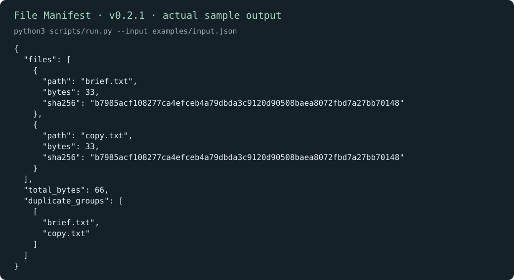

# File Manifest

English | [简体中文](README.zh-CN.md)

Know which files are in a handoff and whether two entries contain the same bytes. Select the files under one local directory; the helper records their sizes, SHA-256 hashes, and duplicate groups.

[Download v0.2.1](https://github.com/KarmenLoop/skill-file-manifest/releases/tag/v0.2.1) · [Tutorial](docs/tutorial.en.md) · [Input reference](docs/INPUT.md) · [Report an issue](https://github.com/KarmenLoop/skill-file-manifest/issues)

## What it does

brief.txt and copy.txt contain identical bytes, so the sample puts both paths in one duplicate group.

Files are read locally. The helper does not upload, rename, delete, or decide which duplicate to keep; symlink components are rejected.



*Actual local output from v0.2.1, rendered as an image. [Complete result](examples/expected.json) · [Image provenance](docs/images/provenance.json).*

## Start here

Download `karmen-file-manifest-v0.2.1.zip` and its `.sha256` file from the release, verify the hash, then extract the ZIP. In the extracted directory, use Python 3.9 or later:

```sh
python3 scripts/run.py --version
python3 scripts/run.py --input examples/input.json
```

Expected version: `karmen-file-manifest 0.2.1`. brief.txt and copy.txt contain identical bytes, so the sample puts both paths in one duplicate group.

To install the complete skill into a host that reads `~/.agents/skills`:

```sh
python3 install.py --host agents
```

The installer refuses an existing destination. Host discovery and invocation vary; see the [full setup and practice guide](docs/tutorial.en.md). You can run the helper directly without an AI host.

## Use it with your own work

Set root to the directory you intend to inspect. List explicit relative file paths in paths; keep them inside root and use real files rather than symbolic links.

Create a second manifest after editing a copied file. Compare hashes to distinguish a renamed identical file from a changed file; review duplicates before any manual cleanup.

Read the [field contract](docs/INPUT.md) before preparing a new input. The helper runs locally with the Python standard library; it needs no model account, API key, or network connection. An AI host has its own data and permission settings.

## Questions

**Does a matching hash prove a download is trustworthy?** It proves byte agreement with that hash. Obtain the expected hash through a source you trust; it does not prove authorship or safety.

**Where does the result go?** JSON is printed to stdout unless you request a new file with `--output`. Existing output files are preserved. The helper reads only the submitted records and any local paths documented in its input contract.

## Documentation and support

- [Download, install, configure, practice, upgrade, and remove](docs/tutorial.en.md)
- [Input/output contract](docs/INPUT.md) and [compatibility](docs/COMPATIBILITY.md)
- [Changelog](CHANGELOG.md), [contributing](CONTRIBUTING.md), [support](SUPPORT.md), and [security reports](SECURITY.md)

## License

[MIT](LICENSE). Keep the license and [notice](NOTICE.md) with redistributed copies. Maintained by [KarmenLoop](https://karmenloop.com).
