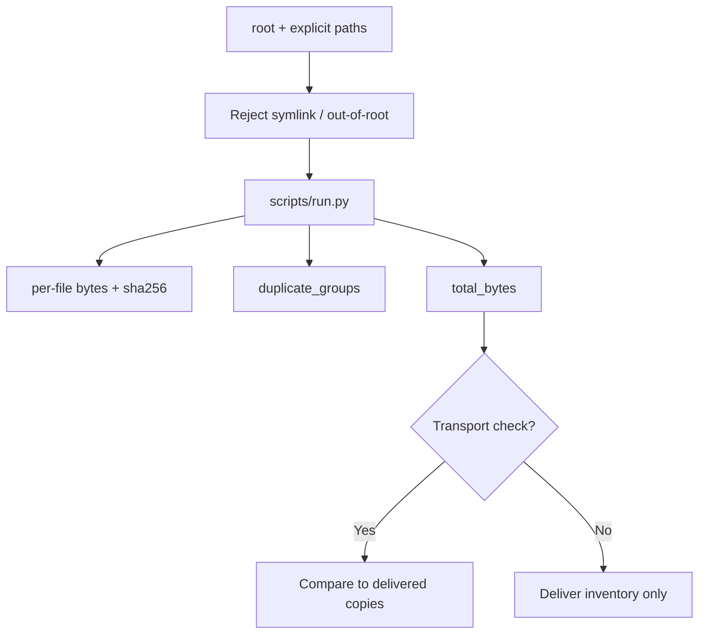

# File Manifest

[English](README.md) · [中文](README.zh-CN.md) · **v0.2.1**

[](https://github.com/KarmenLoop/skill-file-manifest/releases/latest)
[](https://www.python.org/downloads/)
[](LICENSE)
[](skill.json)
[](SKILL.md)

**Know which files are in a handoff—and which entries share the same bytes—before you ship.**

Handoffs go wrong when the zip you meant and the zip you sent diverge, or when two “different” files are byte-identical. **File Manifest** is a portable agent skill plus a local Python helper that reads an explicit file list under one local root and records relative path, byte size, SHA-256, total bytes, and duplicate groups. It does **not** upload, rename, delete, or choose which duplicate to keep; paths with symlink components are rejected.

Built and maintained by [KarmenLoop](https://github.com/KarmenLoop) / [KARMENLOOP](https://karmenloop.com). Current release: **[v0.2.1](https://github.com/KarmenLoop/skill-file-manifest/releases/tag/v0.2.1)**. License: **MIT**.


*Actual local output from v0.2.1, rendered as an image. [Complete result](examples/expected.json) · [Image provenance](docs/images/provenance.json).*

[Download v0.2.1](https://github.com/KarmenLoop/skill-file-manifest/releases/tag/v0.2.1) · [Tutorial](docs/tutorial.en.md) · [中文教程](docs/tutorial.zh-CN.md) · [Input contract](docs/INPUT.md)

---

## Why this exists

Whole-home scans and silent symlink following are how credentials leak into “quick inventories.” This package stays scoped: you name the root and the paths; limits are 1,000 files, 64 MiB per file, and 512 MiB total. A checksum verifies bytes—not functional behavior.

---

## Snapshot

| | |
|---|---|
| **What you install** | Portable skill (`SKILL.md`, docs, examples) + local helper under `scripts/` |
| **Package name** | `karmen-file-manifest` |
| **Version** | **0.2.1** (`skill.json`, release tag, `--version`) |
| **Runtime** | Python **3.9+**, standard library only |
| **Network** | Helper: **offline** (`"network": false` in `skill.json`) |
| **Entry** | `python3 scripts/run.py --input …` · optional `python3 install.py --host agents` |
| **Sample artifact** | [examples/input.json](examples/input.json) → [examples/expected.json](examples/expected.json) |
| **License** | [MIT](LICENSE) — keep [NOTICE.md](NOTICE.md) with redistributed copies |

---

## Is / Is not

| Is | Is not |
|---|---|
| Local manifest: path, size, SHA-256, duplicates | Cloud upload or sync client |
| Explicit path list under one root | Whole-disk / home directory scanner |
| Symlink components rejected | Automatic dedupe deletion |
| Hard limits (1000 files / 64 MiB / 512 MiB) | Filesystem sandbox guarantee |
| Portable skill + stdlib helper | Backup or antivirus suite |

---

## How it works

1. **Method layer** — confirm handoff root and intended list; exclude credentials; compare hashes to delivered copies only when transport verification is requested; upload only to the requested destination.
2. **Helper** — read listed regular files only; hash; group duplicates; emit totals.

### Flow



### Sample (v0.2.1)

`brief.txt` and `copy.txt` share identical bytes, so both paths land in one `duplicate_groups` entry (`total_bytes`: 66). See [examples/expected.json](examples/expected.json) and `examples/files/`.

---

## Quickstart

### A. Run the helper (no agent host required)

1. Download `karmen-file-manifest-v0.2.1.zip` and its `.sha256` from the [v0.2.1 release](https://github.com/KarmenLoop/skill-file-manifest/releases/tag/v0.2.1).
2. Verify the hash, then extract.
3. In the extracted directory, with Python 3.9+:

```sh
python3 scripts/run.py --version
python3 scripts/run.py --input examples/input.json
```

Expected version string: `karmen-file-manifest 0.2.1`. JSON lands on stdout. Use `--output new-result.json` to keep a copy without overwriting existing files. Pipe mode: `--input -`.

### B. Install the portable skill

For hosts that read `~/.agents/skills` (or a project `.agents/skills`):

```sh
python3 install.py --host agents
```

The installer **refuses an existing destination**—use a fresh path or remove the old copy first. Host discovery and invocation vary; see [docs/tutorial.en.md](docs/tutorial.en.md). You can keep using the helper directly without any AI host.

### Use it with your own work

- Set `root` to the directory you intend to inspect.
- List explicit relative paths in `paths`; keep them inside `root`; use real files, not symlinks.
- Do not expand a small handoff into a whole-home scan.
- Remember: matching SHA-256 proves bytes, not that the software still works.

Read [docs/INPUT.md](docs/INPUT.md) before preparing new input. The helper needs no model account, API key, or network connection. An AI host has its own data and permission settings; this skill adds no authority to send, purchase, publish, or change access.

---

## Documentation map

| Doc | Use it when you need… |
|---|---|
| [Tutorial (EN)](docs/tutorial.en.md) · [中文](docs/tutorial.zh-CN.md) | Download, install, practice, upgrade, remove |
| [INPUT.md](docs/INPUT.md) · [input.zh-CN.md](docs/input.zh-CN.md) | Field contract |
| [COMPATIBILITY.md](docs/COMPATIBILITY.md) | Host / runtime notes |
| [VALIDATION.md](docs/VALIDATION.md) | What checks cover |
| [SOURCES.md](docs/SOURCES.md) | Provenance pointers |
| [CHANGELOG.md](CHANGELOG.md) | History through 0.2.1 |
| [SECURITY.md](SECURITY.md) / [SUPPORT.md](SUPPORT.md) / [CONTRIBUTING.md](CONTRIBUTING.md) | Ops |

---

## FAQ

### What is File Manifest in one sentence?

A MIT-licensed agent skill and offline helper that builds a SHA-256 inventory and duplicate groups for an explicit local file list.

### Will it upload or delete files?

No. Read-only. Choosing which duplicate to keep is a separate human decision.

### Why are symlinks rejected?

Following links silently can pull credentials or unrelated trees into a handoff inventory.

### What are the size limits?

1,000 files, 64 MiB per file, 512 MiB total (see skill and input docs).

### Can concurrent writers change files mid-run?

The helper is not a filesystem sandbox; another process can replace bytes after hashing. Treat results as point-in-time.

### Soft discoverability

Useful phrases: **SHA-256 file manifest for handoff**, **duplicate file group detection**, **offline delivery checksum skill**, **scoped local inventory for agents**. Avoid stuffing; the substance is in the skill and helper, not keyword density.

---

## License and contact

[MIT](LICENSE). Keep the license and [NOTICE.md](NOTICE.md) with redistributed copies.

Maintainer: [KarmenLoop](https://github.com/KarmenLoop) · Site: [karmenloop.com](https://karmenloop.com)

Issues: [GitHub Issues](https://github.com/KarmenLoop/skill-file-manifest/issues) · Support policy: [SUPPORT.md](SUPPORT.md). Prefer synthetic data when filing example bugs.
