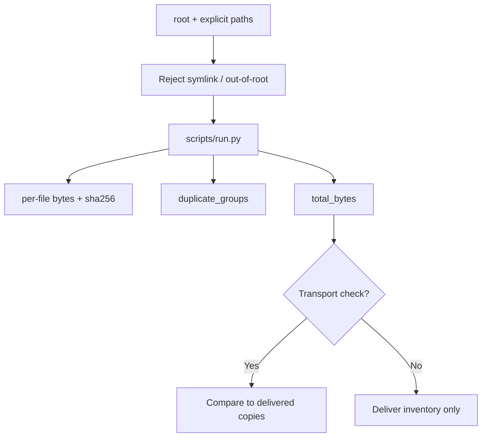

# 文件清单 · File Manifest

[English](README.md) · [中文](README.zh-CN.md) · **v0.2.1**

[](https://github.com/KarmenLoop/skill-file-manifest/releases/latest)
[](https://www.python.org/downloads/)
[](LICENSE)
[](skill.json)
[](SKILL.md)

**交付前确认清单里有哪些文件、哪些内容字节相同。**

你以为发出去的包与实际发出的不一致，或两个“不同”文件其实字节相同——交付就会出错。**文件清单**是可移植的 Agent Skill，外加本地 Python 助手：在选定本地根目录下读取显式文件列表，记录相对路径、大小、SHA-256、总字节与重复分组。它**不会上传、重命名、删除或替你决定保留哪个副本**；含符号链接组件的路径会被拒绝。

由 [KarmenLoop](https://github.com/KarmenLoop) / [KARMENLOOP](https://karmenloop.com) 维护。当前发行版：**[v0.2.1](https://github.com/KarmenLoop/skill-file-manifest/releases/tag/v0.2.1)**。许可：**MIT**。


*图片来自 v0.2.1 的真实本地输出（英文键名）。[完整结果](examples/expected.json) · [图片来源记录](docs/images/provenance.json)。*

[下载 v0.2.1](https://github.com/KarmenLoop/skill-file-manifest/releases/tag/v0.2.1) · [中文教程](docs/tutorial.zh-CN.md) · [English tutorial](docs/tutorial.en.md) · [输入契约](docs/input.zh-CN.md)

---

## 为什么需要它

全盘扫描和悄悄跟随符号链接，是凭据混进“快速清单”的常见路径。本包保持范围可控：由你指定根目录与路径；上限为 1,000 个文件、单文件 64 MiB、合计 512 MiB。校验和验证的是字节——不是功能行为。

---

## 一览

| | |
|---|---|
| **安装内容** | 可移植 Skill（`SKILL.md`、文档、样例）+ `scripts/` 下本地助手 |
| **包名** | `karmen-file-manifest` |
| **版本** | **0.2.1**（`skill.json`、发行标签、`--version`） |
| **运行时** | Python **3.9+**，仅标准库 |
| **网络** | 助手：**离线**（`skill.json` 中 `"network": false`） |
| **入口** | `python3 scripts/run.py --input …` · 可选 `python3 install.py --host agents` |
| **样例产物** | [examples/input.json](examples/input.json) → [examples/expected.json](examples/expected.json) |
| **许可** | [MIT](LICENSE) — 再分发时保留 [NOTICE.md](NOTICE.md) |

---

## 是 / 不是

| Is | Is not |
|---|---|
| 本地清单：路径、大小、SHA-256、重复组 | 云上传或同步客户端 |
| 单根目录下的显式路径列表 | 全盘 / 用户主目录扫描 |
| 拒绝含符号链接组件的路径 | 自动删除重复文件 |
| 硬上限（1000 文件 / 64 MiB / 512 MiB） | 文件系统沙箱保证 |
| 可移植 Skill + 标准库助手 | 备份或杀毒套件 |

---

## 如何工作

1. **方法层** — 确认交付根目录与拟包含文件；排除凭据；仅在要求传输核验时与收件副本比哈希；只上传到被请求的目的地。
2. **助手** — 只读列出的常规文件；计算哈希；分组重复；输出合计。

### 流程



### 样例（v0.2.1）

`brief.txt` 与 `copy.txt` 字节相同，因此进入同一 `duplicate_groups`（`total_bytes`: 66）。详见 [examples/expected.json](examples/expected.json) 与 `examples/files/`。

---

## 快速开始

### A. 直接跑助手（不需要 AI 宿主）

1. 从 [v0.2.1 发行页](https://github.com/KarmenLoop/skill-file-manifest/releases/tag/v0.2.1) 下载 `karmen-file-manifest-v0.2.1.zip` 与对应 `.sha256`。
2. 核对哈希后解压。
3. 在解压目录中使用 Python 3.9+：

```sh
python3 scripts/run.py --version
python3 scripts/run.py --input examples/input.json
```

期望版本字符串：`karmen-file-manifest 0.2.1`。JSON 默认输出到 stdout。用 `--output new-result.json` 落盘且不覆盖已有文件。管道：`--input -`。

### B. 安装可移植 Skill

若宿主读取 `~/.agents/skills`（或项目内 `.agents/skills`）：

```sh
python3 install.py --host agents
```

安装器**拒绝已存在的目标目录**——请换新路径或先移除旧副本。宿主发现与调用方式因环境而异；见 [docs/tutorial.zh-CN.md](docs/tutorial.zh-CN.md)。也可以完全不装宿主，只跑助手。

### 用于你自己的工作

- 将 `root` 设为你要检查的目录。
- 在 `paths` 中列出显式相对路径；保持在 `root` 内；使用真实文件而非符号链接。
- 不要把小范围交付扩大成全主目录扫描。
- 记住：SHA-256 一致只证明字节相同，不证明软件仍可用。

准备新输入前请阅读 [docs/input.zh-CN.md](docs/input.zh-CN.md) / [docs/INPUT.md](docs/INPUT.md)。助手不需要模型账号、API 密钥或网络。AI 宿主有自己的数据与权限设定；本 Skill **不**额外授予发送、购买、发布或改权限的权力。

---

## 文档地图

| 文档 | 用途 |
|---|---|
| [中文教程](docs/tutorial.zh-CN.md) · [English](docs/tutorial.en.md) | 下载、安装、练习、升级、移除 |
| [input.zh-CN.md](docs/input.zh-CN.md) · [INPUT.md](docs/INPUT.md) | 字段契约 |
| [COMPATIBILITY.md](docs/COMPATIBILITY.md) | 宿主 / 运行时说明 |
| [VALIDATION.md](docs/VALIDATION.md) | 校验覆盖范围 |
| [SOURCES.md](docs/SOURCES.md) | 来源与溯源 |
| [CHANGELOG.md](CHANGELOG.md) | 至 0.2.1 的历史 |
| [SECURITY.md](SECURITY.md) / [SUPPORT.md](SUPPORT.md) / [CONTRIBUTING.md](CONTRIBUTING.md) | 运维 |

---

## 常见问题

### 一句话：文件清单是什么？

MIT 许可的 Agent Skill 与离线助手：对显式本地文件列表生成 SHA-256 清单与重复分组。

### 会上传或删除文件吗？

不会。只读。保留哪个副本由人另行决定。

### 为什么拒绝符号链接？

悄悄跟随链接可能把凭据或不相关目录拉进交付清单。

### 大小上限是多少？

1,000 个文件、单文件 64 MiB、合计 512 MiB（见 Skill 与输入文档）。

### 运行中文件被别的进程改了怎么办？

助手不是文件系统沙箱；哈希之后字节仍可能被替换。结果应按时间点理解。

### 温和可发现性

可用检索说法：**交付用 SHA-256 文件清单**、**重复文件分组检测**、**离线交付校验 Skill**、**面向代理的限定范围本地清单**。 避免堆砌；实质在 Skill 与助手里，不在关键词密度。

---

## 许可与联系

[MIT](LICENSE)。再分发时请保留许可证与 [NOTICE.md](NOTICE.md)。

维护者：[KarmenLoop](https://github.com/KarmenLoop) · 站点：[karmenloop.com](https://karmenloop.com)

问题反馈：[GitHub Issues](https://github.com/KarmenLoop/skill-file-manifest/issues) · 支持政策：[SUPPORT.md](SUPPORT.md)。提交样例相关问题时请优先使用合成数据。
